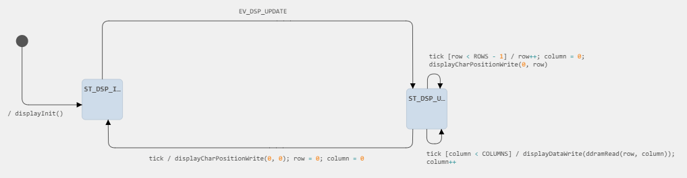
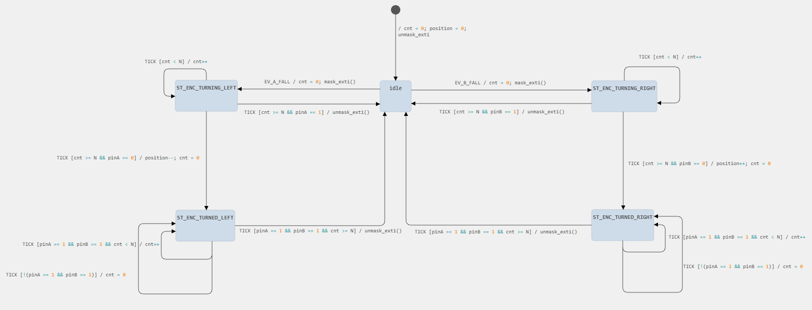
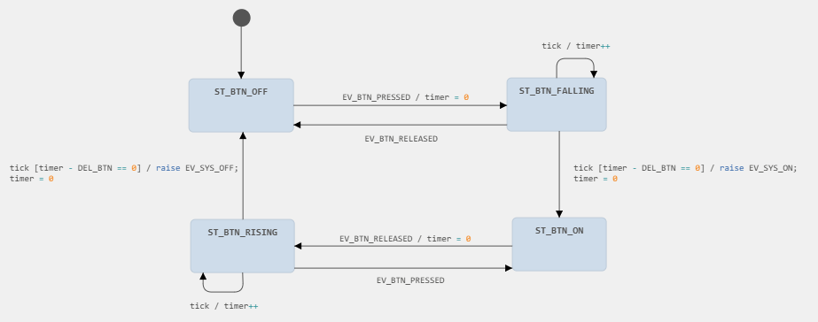
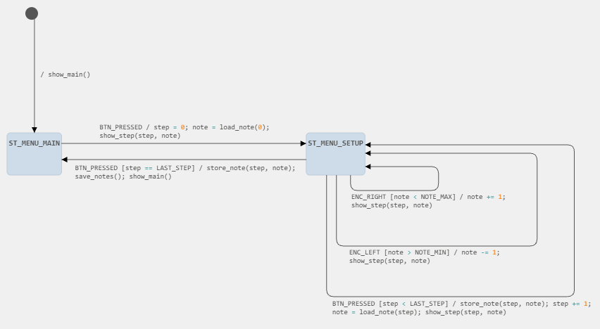

# Avance 20/11

> **Contenido**
> 1. [Pendientes completados](#1-pendientes-completados)
> 2. [Pendientes próxima semana](#2-pendientes-próxima-semana)
> 3. [Lista de componentes](#3-lista-de-componentes)
> 4. [Statecharts](#4-statecharts)
> 5. [asignación de pines](#5-asignación-de-pines)
> 6. [Codificación del proyecto](#6-codificación-del-proyecto)

---

## 1. Pendientes completados

- [x] Selección de pines en `.ioc` en base a distribución de componentes en la placa experimental
- [x] Statecharts de cada elemento del circuito
- [x] Selección de bibliotecas a reutilizar y/o modificar de TPs realizados en el cuatrimestre
- [x] Estructuración de plan de desarrollo a seguir
- [x] Programación de librería de Encoder y flujo de encole de eventos

---

## 2. Pendientes próxima semana

- [ ] Libreria MIDI.
- [ ] programar `task_sensor`

---

## 3. Lista de componentes

Luego del analisis de los requerimientos funcionales propuestos en la propuesta de proyecto, se seleccionaron los siguientes componentes para el desarrollo del mismo.

- Encoder con pulsador de 20 pasos
- potenciómetro 10k ohm
- display LCD 16x2 con modulo I2C
- 8 diodos led
- decodificador de 3 entradas a 8 salidas para control de encendido de leds
- conector hembra MIDI DIN (Se elimino la implementación del parlante)

---

## 4. Statecharts

A continuación se establecen los flujos de funcionamiento de los distintos elementos del sistema

### 4.1 Display

*Figura 1: Diagrama de flujo del display (reutilizado de TP 3)*

### 4.2 Perilla encoder

*Figura 2: Diagrama de flujo de la perilla del encoder con debouncing y confirmación de estado por tiempo*

### 4.3 Boton encoder

*Figura 3: Diagrama de flujo del botón de encoder con debouncing (reutilizado de TP 1)*

### 4.4 Menu Set-Up

*Figura 4: Diagrama de flujo de modo Set-Up*

---

## 5. asignación de pines

### 5.1 Pin set en `.ioc` y generación de código

Para cada componente del sistema de seleccionaron los pines de la siguiente forma:

| Componente | Pines |
| :--- | :--- |
| **Encoder** | `CLK`: PB6 (D10) `DT`: PC7 (D9) `SW`: PA9 (D8) `3,3V` `GND` |
| **Display** | `SDA`: PB9 (D14) `SCL`: PB8 (D15) `3,3V` `GND` |
| **Potenciometro** | `ADC`: PA0 (A0) `3,3V` `GND` |
| **Decodificador** | `A`: PB3 (D3) `B`: PB5 (D5) `C`: PB4 (D4) |
| **Midi** | `TX`: PB10 (D6) |

---

## 6. Codificación del proyecto

### 6.1 Plantilla: TP0 act 3

Se optó por desarrollar el proyecto bajo el patrón de diseño *Cylce Executive* ejecutando tareas cíclicas con periodo de `1ms` con la arquitectura **Escrutar - Procesar - Actuar** integrada mediante *Statecharts* representados con estructuras `switch-case`.

### 6.2 Creación de un Plan de Implementación

Una vez armados los diagramas de flujo, seleccionado los componentes, pines y bibliotecas a utilizar. Se desarrollo un plan de implementación detallado guiado por un LLM utilizando como base los proyectos, requerimientos y lo que teníamos diseñado como el principio de funcionamiento del dispositivo.

Si bien el LLM brinda en el plan un diseño de statecharts, se optó por usar los de desarrollo propio ya que poseemos mayor contexto y compresión de los requerimientos deseados, además de tener algunos diagramas ya elaborados en el transcurso del cuatrimestre.

> [Plan de implementacion](./implementation_plan.md)

### 6.3 Programación de encoder

Se programó prácticamente desde cero para comprender mejor el flujo de encole de eventos y asimilar conceptos vistos en clase y TPs.

Se verificó que no tenga funciones bloqueantes y que el WCET sea mucho menor a `1ms`

### 6.4 Modificación Librería LCD paralelo a i2c

Se adaptó la libreria LCD paralelo usada en el TP3 para usar un LCD con modulo i2c, guiados mediante un LLM para la codificación.