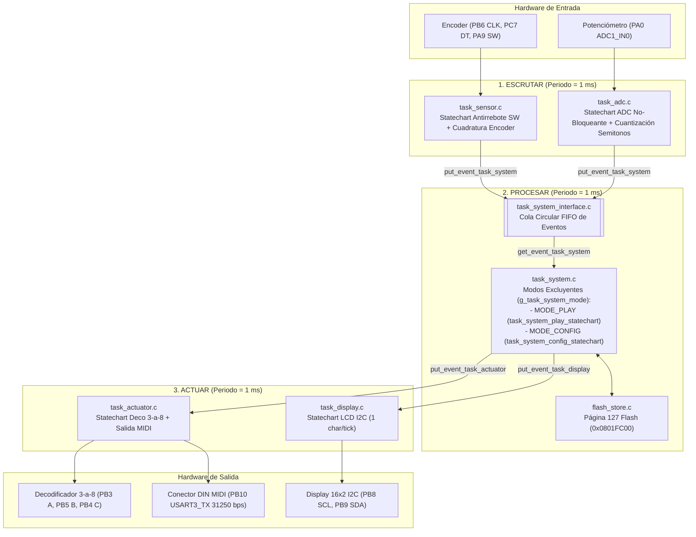
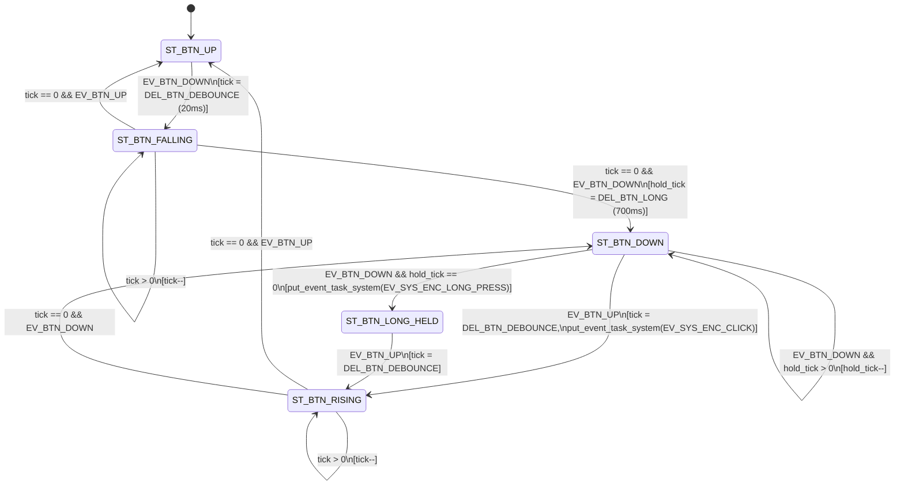
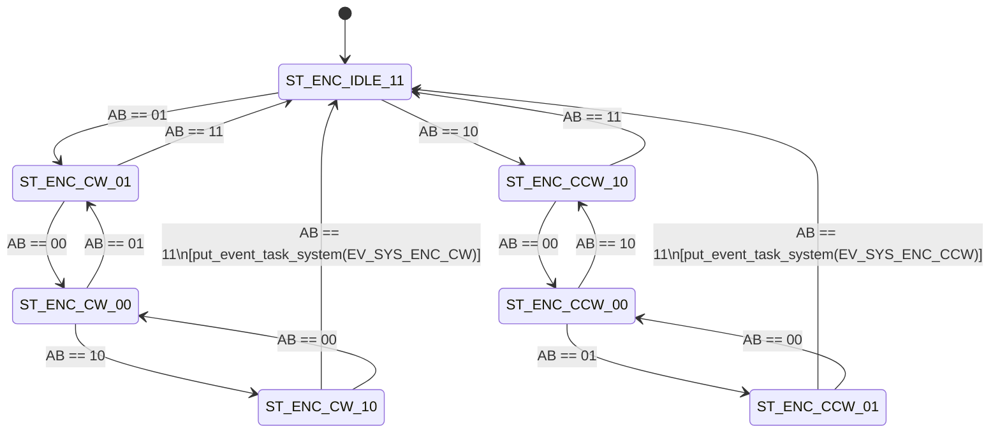
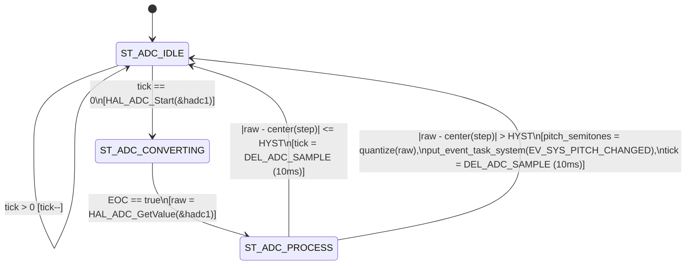
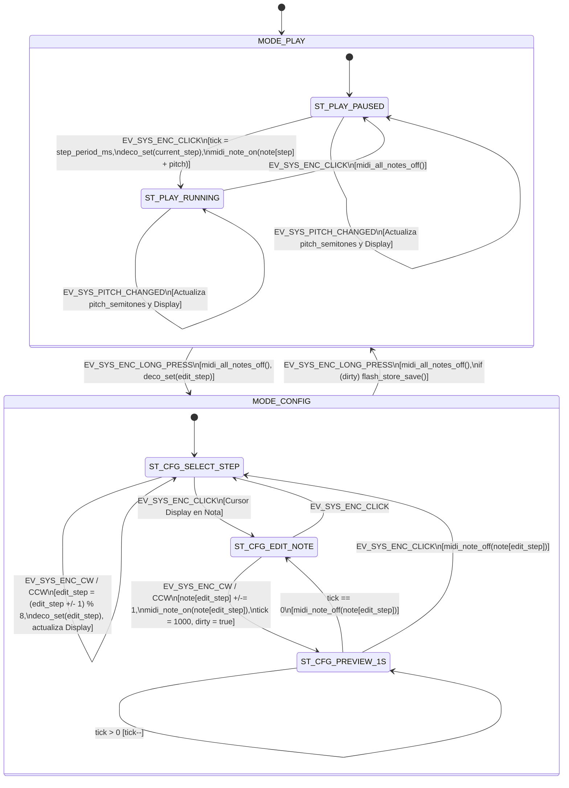
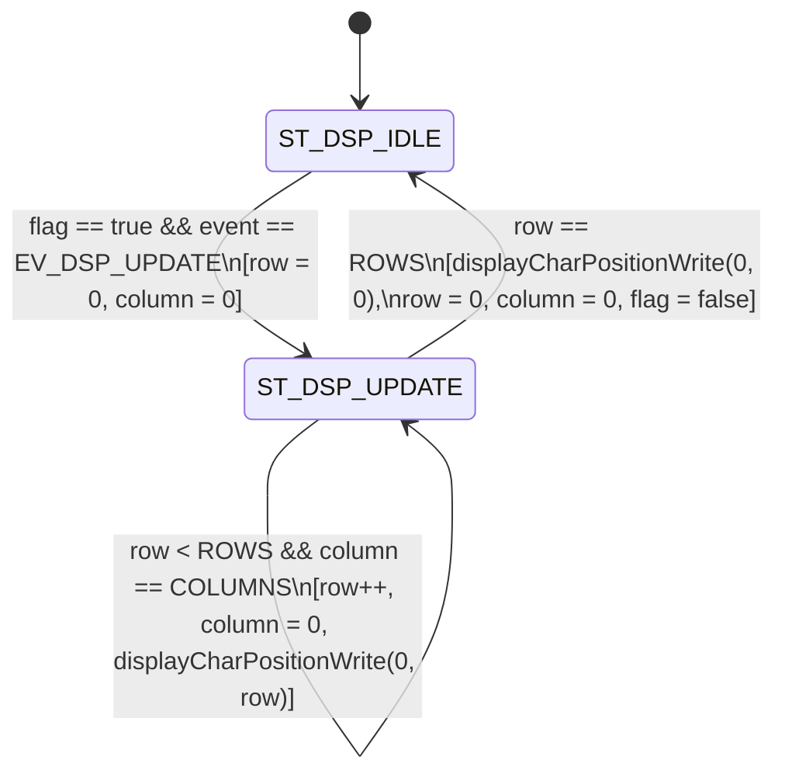
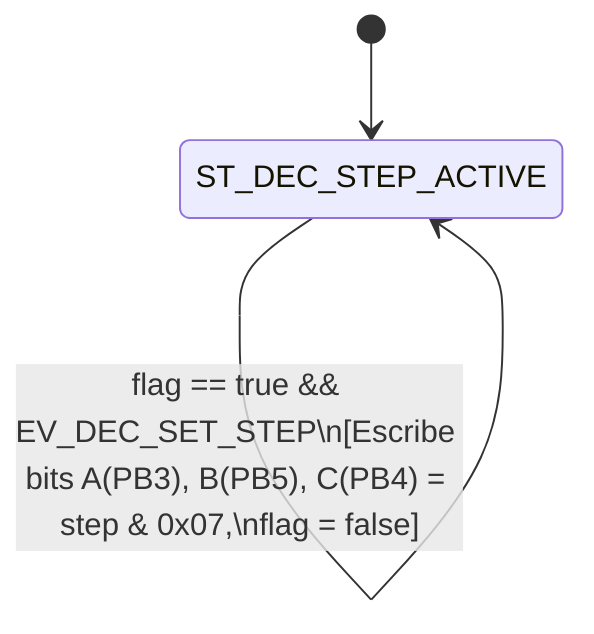

# Documento de Diseño e Implementación: Sequencer MIDI de 8 Pasos

## Goal Description

Implementar un **Sequencer MIDI de 8 pasos** sobre la placa **NUCLEO-F103RB** en el proyecto [`tdse-tf-2026`](file:///home/joaquin/STM32CubeIDE/tdse-tf-2026), bajo el patrón de diseño **Cyclic Executive (`period = 1 ms`)** y la arquitectura **Escrutar – Procesar – Actuar** integrada mediante **Statecharts (`switch-case`)**.

El sistema permite:
1. **Modo Configuración (`MODE_CONFIG`):** Seleccionar cualquiera de los 8 pasos mediante un encoder rotativo de 20 pasos con pulsador integrado (`ENC_SW`), visualizar el paso en una barra de 8 LEDs controlada por un decodificador 3-a-8 y en un Display LCD 16x2 I2C, ajustar la nota MIDI de cada paso escuchando una previsualización de `1 segundo` por salida MIDI DIN, y almacenar la secuencia de forma no volátil en la memoria Flash interna del STM32F103RB al salir del modo.
2. **Modo Reproducción (`MODE_PLAY`):** Iniciar y pausar la secuencia de 8 pasos con indicación luminosa en el decodificador de 8 LEDs, emisión de mensajes MIDI (`Note On` / `Note Off`) a `31250 bps` y transposición dinámica de tono (*pitch* cuantizado en semitonos) en tiempo real mediante un potenciómetro analógico (`ADC1`).
3. **Restricción de Tiempo Real:** Todas las tareas son no bloqueantes y cumplen que el tiempo de ejecución de peor caso total por ciclo sea menor al período del SysTick ($\sum \text{WCET} < 1000\ \mu\text{s} \implies U < 1$).

---

## User Review Required

> [!IMPORTANT]
> **Reasignación de Pines Especiales en STM32F103RB (`AFIO Remap`)**
> - **Decodificador en `PB3` y `PB4`:** Tras el reset, `PB3` (`JTDO`) y `PB4` (`JNTRST`) pertenecen al puerto JTAG. Se ejecuta `__HAL_AFIO_REMAP_SWJ_NOJTAG()` en `MX_GPIO_Init()` para habilitar `PB3` y `PB4` como salidas GPIO manteniendo operativo el depurador SWD (`PA13`/`PA14`).
> - **I2C1 en `PB8`/`PB9` y `PB6` para Encoder:** Por defecto `I2C1_SCL` ocupa `PB6`. Se activa `__HAL_AFIO_REMAP_I2C1_ENABLE()` para trasladar `I2C1` a `PB8` (`SCL`) y `PB9` (`SDA`), liberando `PB6` como entrada digital para `ENC_CLK`.

> [!WARNING]
> **Restricción de Presupuesto Temporal (`WCET < 1000 us`) en Periféricos Serie**
> - **Display I2C (`PCF8574`):** El refresco del LCD 16x2 se divide mediante el statechart de `task_display` enviando **1 carácter (o comando de posición) por cada tick de `1 ms`**, evitando bloqueos de varios milisegundos en el bus I2C.
> - **MIDI UART (`USART3` a `31250 bps`):** La transmisión de los 3 bytes de cada comando MIDI se realiza de forma no bloqueante por interrupción (`HAL_UART_Transmit_IT`) a través de una cola circular de salida.

> [!CAUTION]
> **Grabación en Memoria Flash Interna (`0x0801FC00`)**
> El borrado de página en Flash interna detiene el bus de instrucciones durante `~20 ms`. Por diseño, la rutina `flash_store_save()` se invoca únicamente en la transición de salida `MODE_CONFIG -> MODE_PLAY` con el secuenciador detenido y sólo si se registraron modificaciones en las notas (*dirty flag*).

---

## Arquitectura del Sistema y Diagramas de Estado (Statecharts)

### 1. Flujo de Datos Escrutar – Procesar – Actuar



---

### 2. Statecharts de la Etapa ESCRUTAR (`task_sensor` y `task_adc`)

#### 2.1 Statechart de Pulsador con Detección de Click Corto y Pulsación Larga (`ENC_SW` en `PA9`)
Al contar con un único botón físico (`ENC_SW`), el statechart discrimina entre pulsación corta (`EV_SYS_ENC_CLICK` para seleccionar/confirmar/Play-Pause) y pulsación larga de `700 ms` (`EV_SYS_ENC_LONG_PRESS` para conmutar entre `MODE_PLAY` y `MODE_CONFIG`).



#### 2.2 Statechart del Encoder Rotativo en Cuadratura (`PB6` CLK, `PC7` DT)
Sigue las 4 fases del código Gray de 2 bits `(CLK << 1) | DT` entre posición de reposo (`11`) y pasos intermedios (`01`, `00`, `10`) para rechazar rebotes mecánicos sin perder pulsos:



#### 2.3 Statechart de Lectura de ADC y Cuantización de Semitonos (`task_adc` en `PA0`)



---

### 3. Statechart de la Etapa PROCESAR (`task_system` — Modos Excluyentes)



---

### 4. Statecharts de la Etapa ACTUAR (`task_actuator` y `task_display`)

#### 4.1 Statechart de `task_display` (Refresco No-Bloqueante 1 Carácter por Tick sobre I2C)



#### 4.2 Statechart de `task_actuator` (Decodificador 3-a-8 de LEDs + Salida MIDI)



---

## Mapa de Pines Completo (`Core/Inc/main.h` y `app/inc/board.h`)

| Periférico | Nombre en Código | Pin STM32 | Conector Nucleo | Modo HAL |
| :--- | :--- | :--- | :--- | :--- |
| **Encoder CLK** | `ENC_CLK_Pin` | `PB6` | `D10` | `GPIO_MODE_INPUT` (`GPIO_PULLUP`) |
| **Encoder DT** | `ENC_DT_Pin` | `PC7` | `D9` | `GPIO_MODE_INPUT` (`GPIO_PULLUP`) |
| **Encoder SW** | `ENC_SW_Pin` | `PA9` | `D8` | `GPIO_MODE_INPUT` (`GPIO_PULLUP`) |
| **Deco Bit A (LSB)** | `DEC_A_Pin` | `PB3` | `D3` | `GPIO_MODE_OUTPUT_PP` |
| **Deco Bit B** | `DEC_B_Pin` | `PB5` | `D4` | `GPIO_MODE_OUTPUT_PP` |
| **Deco Bit C (MSB)** | `DEC_C_Pin` | `PB4` | `D5` | `GPIO_MODE_OUTPUT_PP` |
| **Display I2C SCL** | `I2C1_SCL` | `PB8` | `D15` | `GPIO_MODE_AF_OD` (`I2C1` Remap) |
| **Display I2C SDA** | `I2C1_SDA` | `PB9` | `D14` | `GPIO_MODE_AF_OD` (`I2C1` Remap) |
| **Potenciómetro** | `PITCH_ADC_Pin` | `PA0` | `A0` | `GPIO_MODE_ANALOG` (`ADC1_IN0`) |
| **MIDI Out TX** | `MIDI_TX_Pin` | `PB10` | `D6` | `GPIO_MODE_AF_PP` (`USART3_TX`, `31250 bps`) |

---

## Proposed Changes (Orden de Implementación Paso a Paso)

### Paso 1: Configuración de Pines, Periféricos HAL y Esqueleto Base en `tdse-tf-2026`

#### [MODIFY] [`Core/Inc/main.h`](file:///home/joaquin/STM32CubeIDE/tdse-tf-2026/Core/Inc/main.h)
- Agregar las definiciones de pines para `ENC_CLK` (`PB6`), `ENC_DT` (`PC7`), `ENC_SW` (`PA9`), `DEC_A` (`PB3`), `DEC_B` (`PB5`), `DEC_C` (`PB4`), `PITCH_ADC` (`PA0`) y `MIDI_TX` (`PB10`).
- Habilitar los módulos `HAL_ADC_MODULE_ENABLED` y `HAL_I2C_MODULE_ENABLED` en [`Core/Inc/stm32f1xx_hal_conf.h`](file:///home/joaquin/STM32CubeIDE/tdse-tf-2026/Core/Inc/stm32f1xx_hal_conf.h) y sus fuentes en `Drivers/STM32F1xx_HAL_Driver/Src/`.

#### [MODIFY] [`Core/Src/main.c`](file:///home/joaquin/STM32CubeIDE/tdse-tf-2026/Core/Src/main.c)
- Declarar los handlers globales `ADC_HandleTypeDef hadc1`, `I2C_HandleTypeDef hi2c1` y `UART_HandleTypeDef huart3`.
- En `MX_GPIO_Init()`: ejecutar `__HAL_RCC_AFIO_CLK_ENABLE()` y `__HAL_AFIO_REMAP_SWJ_NOJTAG()`, e inicializar `PB6`, `PC7`, `PA9` como entradas con pull-up y `PB3`, `PB5`, `PB4` como salidas push-pull.
- Agregar `MX_ADC1_Init()` (`PA0` / canal 0), `MX_I2C1_Init()` (`400 kHz` con `__HAL_AFIO_REMAP_I2C1_ENABLE()` en `PB8`/`PB9`) y `MX_USART3_UART_Init()` (`31250 bps` en `PB10` con interrupción NVIC habilitada).

#### [MODIFY] [`app/inc/board.h`](file:///home/joaquin/STM32CubeIDE/tdse-tf-2026/app/inc/board.h)
- Mapear los alias de placa (`ENC_CLK_PORT/PIN`, `ENC_DT_PORT/PIN`, `ENC_SW_PORT/PIN`, `DEC_A/B/C_PORT/PIN`) para `NUCLEO_F103RC`.

#### [DELETE] [`app/inc/task_a.h`](file:///home/joaquin/STM32CubeIDE/tdse-tf-2026/app/inc/task_a.h), [`app/inc/task_b.h`](file:///home/joaquin/STM32CubeIDE/tdse-tf-2026/app/inc/task_b.h), [`app/src/task_a.c`](file:///home/joaquin/STM32CubeIDE/tdse-tf-2026/app/src/task_a.c), [`app/src/task_b.c`](file:///home/joaquin/STM32CubeIDE/tdse-tf-2026/app/src/task_b.c)
- Reemplazar las tareas de demostración de TP0 por la estructura `task_sensor`, `task_system` y `task_actuator` de [`tdse-tp2_03-mode_integration`](file:///home/joaquin/STM32CubeIDE/workspace_1.19.0/tdse-tp2_03-mode_integration/app).

---

### Paso 2: Implementación de `task_sensor` + Librería de Encoder (Desarrollada por el Usuario)

#### [NEW] `app/inc/task_sensor.h`, `app/inc/task_sensor_attribute.h`, `app/src/task_sensor.c`
- Incorporar la tabla de configuración para el botón `ID_BTN_ENC_SW` (`PA9`) y la invocación al módulo del encoder en cada ciclo de `1 ms`, disparando hacia `task_system` los eventos:
  ```c
  typedef enum task_system_ev {
      EV_SYS_IDLE,
      EV_SYS_ENC_CW,
      EV_SYS_ENC_CCW,
      EV_SYS_ENC_CLICK,
      EV_SYS_ENC_LONG_PRESS,
      EV_SYS_PITCH_CHANGED
  } task_system_ev_t;
  ```

#### [NEW] `app/inc/encoder.h`, `app/src/encoder.c`
- Módulo dedicado que lee `ENC_CLK` (`PB6`) y `ENC_DT` (`PC7`) y ejecuta el statechart de cuadratura (Sección 2.2) para ser programado y probado sobre la placa antes de avanzar al resto de periféricos.

---

### Paso 3: Módulos de Salida (`deco_leds`, `display` I2C, `midi`) y `task_adc`

#### [NEW] `app/inc/task_actuator.h`, `app/inc/task_actuator_attribute.h`, `app/inc/task_actuator_interface.h`, `app/src/task_actuator.c`, `app/src/task_actuator_interface.c`
- Tabla de estados de las 3 salidas del decodificador (`DEC_C`, `DEC_B`, `DEC_A`) para los 8 LEDs:
  ```c
  typedef struct {
      uint8_t step_id;
      GPIO_PinState pin_a; // PB3 (LSB)
      GPIO_PinState pin_b; // PB5
      GPIO_PinState pin_c; // PB4 (MSB)
  } deco_led_cfg_t;
  ```
- Función de interfaz `put_step_task_actuator(uint8_t step)` y `put_event_task_actuator(task_actuator_ev_t event, task_actuator_id_t id)`.

#### [NEW] `app/inc/display.h`, `app/src/display.c`, `app/inc/task_display.h`, `app/inc/task_display_attribute.h`, `app/inc/task_display_interface.h`, `app/src/task_display.c`, `app/src/task_display_interface.c`
- Copiar la implementación de 1 carácter por tick de [`tdse-tp3_02-porting_c_code/app/src/task_display.c`](file:///home/joaquin/tdse-tp3_2026-2doC_1-04/TP3%20-%20Actividad%202/tdse-tp3_02-porting_c_code/app/src/task_display.c).
- Adaptar `display.c` agregando `DISPLAY_CONNECTION_I2C_PCF8574` para transmitir cada byte de comando/dato en modo 4 bits sobre `hi2c1` (`PB8`/`PB9`, dirección `0x27 << 1`).

#### [NEW] `app/inc/task_adc.h`, `app/inc/task_adc_attribute.h`, `app/src/task_adc.c`
- Implementar el statechart de muestreo no bloqueante sobre `hadc1` (`PA0`) cada `10 ms` con cuantización a semitonos (`-12` a `+12`) e histéresis de `25` cuentas LSB.

#### [NEW] `app/inc/midi.h`, `app/src/midi.c`
- Implementar el transmisor MIDI sobre `huart3` (`PB10`, `31250 bps`) usando transmisión no bloqueante (`HAL_UART_Transmit_IT`) con funciones `midi_send_note_on(uint8_t note, uint8_t velocity)`, `midi_send_note_off(uint8_t note)` y `midi_all_notes_off(void)`.

---

### Paso 4: Prueba de Integración Reducida ("Mini-Sequencer")

#### [NEW] `app/inc/task_system.h`, `app/inc/task_system_attribute.h`, `app/inc/task_system_interface.h`, `app/src/task_system.c`, `app/src/task_system_interface.c`
- Bajo el flag `#define TEST_MODE_MINI_SEQUENCER (1)` en `app.h`, implementar un statechart reducido en `task_system.c` donde:
  - El giro del encoder selecciona el paso `0..7` en el Decodificador de LEDs y ajusta una única nota MIDI reproduciéndola por `1 s`.
  - El potenciómetro transponga la nota en semitonos.
  - El Display I2C muestre en vivo el paso, la nota y el pitch, verificando la correcta comunicación de todas las colas e interfaces y que $\sum \text{WCET} < 1000\ \mu\text{s}$.

---

### Paso 5: Sequencer Completo de 8 Pasos y Persistencia en Flash

#### [NEW] `app/inc/flash_store.h`, `app/src/flash_store.c`
- Lectura al arranque (`flash_store_load(uint8_t notes[8])`) y grabación al salir de configuración (`flash_store_save(const uint8_t notes[8])`) sobre la página `0x0801FC00` de la Flash interna del STM32F103RB.

#### [MODIFY] `app/src/task_system.c`
- Activar los dos modos excluyentes completos (`MODE_PLAY` y `MODE_CONFIG`) según el diagrama de estados de la Sección 3.

---

## Verification Plan

### Automated Tests (Compilación y Enlazado)
En cada paso se verificará la compilación limpia (`0 errors, 0 warnings`) mediante el builder headless de STM32CubeIDE:
```bash
/opt/st/stm32cubeide_1.19.0/stm32cubeide --launcher.suppressErrors -nosplash \
  -application org.eclipse.cdt.managedbuilder.core.headlessbuild \
  -data /tmp/stm32_test_ws \
  -import /home/joaquin/STM32CubeIDE/tdse-tf-2026 \
  -build tdse-tf-2026/Debug
```

### Manual & Hardware Verification
1. **Verificación Paso 1 y 2 (Pines + Encoder):**
   - Inspeccionar en *Live Expressions* (`event_task_system_queue`, `task_sensor_dta_list`) que girar el encoder en `PB6`/`PC7` encola `EV_SYS_ENC_CW` y `EV_SYS_ENC_CCW`, y que presionar `PA9` encola `EV_SYS_ENC_CLICK` (pulsación corta) y `EV_SYS_ENC_LONG_PRESS` (pulsación $> 700\text{ ms}$).
2. **Verificación Paso 3 (Periféricos de Salida y ADC):**
   - Comprobar el encendido secuencial de los 8 LEDs mediante `PB3`, `PB5`, `PB4`.
   - Comprobar la escritura en el Display I2C (`PB8`/`PB9`) verificando que `task_dta_list[ID_TASK_DISPLAY].WCET < 300 us`.
   - Comprobar la trama MIDI a `31250 bps` en `PB10` y la lectura cuantizada de `PA0`.
3. **Verificación Paso 4 y 5 (Integración y Tiempo Real):**
   - Verificar que `g_app_runtime_us < 1000` ($U < 1$) durante reproducción continua con actualización de display y envío MIDI.
   - Modificar las notas de los 8 pasos en `MODE_CONFIG`, volver a `MODE_PLAY`, desconectar la alimentación de la placa y comprobar que al reiniciar conserva la secuencia almacenada en Flash.
