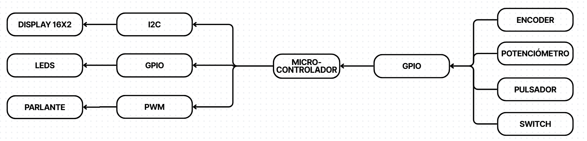
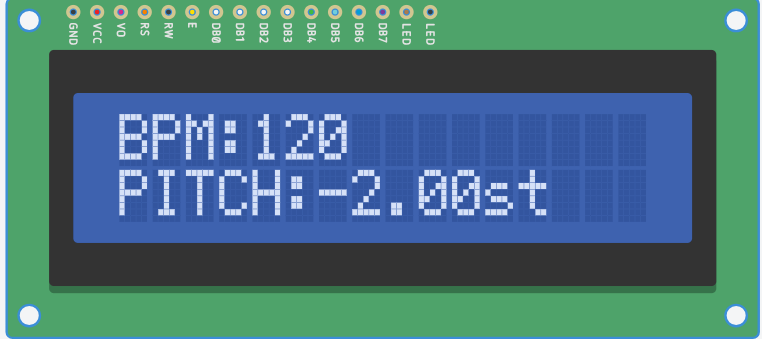
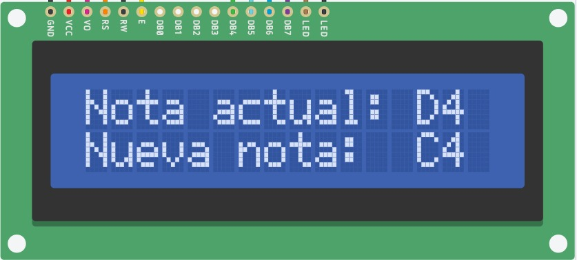

 

# **Secuenciador de 8 pasos (8-Step Sequencer)**

**Autores: Cárdenas Joaquín; Duer Tomás**

**Padrones: 112311; 112612**

**Fecha: 30/10/2026**

### **1\. Selección del proyecto a implementar**

#### **1.1 Objetivo del proyecto y resultados esperados**

El objetivo del proyecto es diseñar e implementar un secuenciador de 8 pasos (*8-Step Sequencer*).

El principio de funcionamiento del dispositivo planteado es el siguiente: cada paso almacena una nota o un silencio, y la secuencia completa se reproduce en bucle a un tempo ajustable.

Los objetivos para poder concluir el diseño del dispositivo son:

- **Menú** de configuración de la nota/silencio de cada paso y del tempo de la secuencia.
- **Indicadores** del paso de la secuencia en tiempo real durante la reproducción.
- **Almacenamiento** de la configuración de notas/silencios y del tempo en memoria flash.
- **Interfaz de audio.**

#### **1.2 Proyectos similares**

Se consideran dos proyectos similares que cumplen con los objetivos y resultados esperados del proyecto:

1. **DIY Arduino 16-Step Sequencer** (16 pasos, LCD y 1 encoder): [repositorio](https://github.com/ChesterLemon/Arduino-Sequencer).
2. **Secuenciador 8x8** (OLED y 2 encoders): [video](https://www.youtube.com/watch?v=jFXoq5d7DWc).

Para comparar estas alternativas, se tienen en cuenta los siguientes aspectos:

1. **Disponibilidad de hardware.**
2. **Funciones:** la cantidad de funciones del dispositivo determina la cantidad de posibilidades que brinda a la hora de generar ritmos.
3. **Tiempo de implementación.**
4. **Costo del proyecto.**
5. **Interés personal.**

Los proyectos similares utilizan un Arduino como microcontrolador. En este análisis se consideran únicamente sus funcionalidades, teniendo en cuenta que estas deben poder implementarse en el microcontrolador utilizado en la materia.

La disponibilidad de hardware es esencial, pues con este proyecto no se apunta a salir del mercado regional. Luego, se busca que el proyecto sea de bajo costo, ya que sus posibles competidores probablemente tengan mayor fidelidad de sonido y mejor calidad de materiales. Si se logra un producto que permita acceder a las funciones típicas de un *sequencer*, pero a un costo mucho menor que el de la competencia, el proyecto podría resultar atractivo para un consumidor interesado en tener un “juguete” con el cual *experimentar* y *divertirse* a bajo costo. El tiempo de implementación debe ser relativamente corto, debido a los plazos de entrega acotados de la materia. Por último, en cuanto al interés personal, se busca que el proyecto sea motivador y permita aprender a utilizar la mayor cantidad de tecnologías dentro de los límites fijados por la consigna.

En la Tabla 1 se muestran los valores ponderados asignados a cada proyecto considerado.

<table>
    <thead>
        <tr>
            <th rowspan="2">Criterio</th>
            <th colspan="2">Proyecto 1: Sequencer 16 pasos (LCD, 1 encoder)</th>
            <th colspan="2">Proyecto 2: Sequencer 8x8 (OLED, 2 encoders)</th>
        </tr>
        <tr>
            <th>Puntaje</th>
            <th>Puntaje Ponderado</th>
            <th>Puntaje</th>
            <th>Puntaje Ponderado</th>
        </tr>
    </thead>
    <tbody>
        <tr>
            <td align="center">Disponibilidad de hardware  (peso: 10)</td>
            <td>10</td><td>100</td>
            <td>10</td><td>100</td>
        </tr>
        <tr>
            <td align="center">Funciones  (peso: 5)</td>
            <td>5</td><td>25</td>
            <td>8</td><td>40</td>
        </tr>
        <tr>
            <td align="center">Tiempo de implementación  (peso: 8)</td>
            <td>7</td><td>56</td>
            <td>4</td><td>32</td>
        </tr>
        <tr>
            <td align="center">Costo del proyecto  (peso: 10)</td>
            <td>10</td><td>100</td>
            <td>4</td><td>40</td>
        </tr>
        <tr>
            <td align="center">Interés personal  (peso: 8)</td>
            <td>8</td><td>64</td>
            <td>7</td><td>56</td>
        </tr>
        <tr>
            <td><strong>Puntaje total</strong></td>
            <td>-</td><td><strong>345</strong></td>
            <td>-</td><td>268</td>
        </tr>
    </tbody>
</table>

<em>Tabla 1: Comparación de proyectos</em>

#### **1.3 Selección de proyecto**

Considerando la Tabla 1, se decidió implementar el primer proyecto listado. Para reducir aún más el tiempo de implementación, se plantea reducir la cantidad de pasos de la secuencia de 16 a 8.

###### **1.3.1 Diagrama en bloques**

En la Figura 1 se muestra el diagrama en bloques del sistema con los principales módulos del proyecto.

  

<em>Figura 1: Diagrama en bloques del sistema</em>

---

### **2\. Elicitación de requisitos y casos de uso**

En el mercado hay instrumentos con secuenciador de pasos, desde cajas de ritmos chicas hasta sintetizadores. Por ejemplo, la **Korg Volca Beats** se consigue en tiendas locales como [B2B Music Store](https://www.b2bmusicstore.com.ar/producto/korg-volca-beats/) a $484.723 ARS (precio de lista al 26/10/2026), tiene 16 pasos, guarda hasta 8 patrones y se puede sincronizar por MIDI. Está pensada para percusión y no tiene una pantalla donde ver la nota de cada paso. Otro ejemplo es el **Behringer Crave**, un sintetizador con secuenciador de 32 pasos que se maneja con perillas y LEDs, también sin pantalla.

Estos productos hacen mucho más que lo que se propone acá y son más caros que un prototipo hecho con componentes comunes. Este proyecto es más simple: un secuenciador de 8 pasos donde se elige la nota o el silencio de cada paso viendo su valor en el LCD, con un interruptor de mute para configurar sin escuchar y con la configuración guardada en la memoria flash.

#### **2.1 Requisitos del proyecto**

En la Tabla 2 se detallan los requisitos del sistema.

| Grupo | ID | Descripción |
| :---- | :---- | :---- |
| Pantalla LCD | 1.1 | El sistema contará con una pantalla LCD para mostrar información de estado. |
|  | 1.2 | Al iniciar el sistema, se mostrará una pantalla de bienvenida durante unos segundos. |
|  | 1.3 | Luego de la bienvenida, comenzará el modo “Loop principal”, donde se mostrarán por pantalla el BPM y el pitch. |
|  | 1.4 | Al entrar en modo “Set-up”, se mostrará la nota del paso en el cual se está parado, junto a la nueva nota seleccionada. |
| Switch | 2.1 | El sistema contará con un switch que funcionará como interruptor de mute. |
|  | 2.2 | Con el switch en posición “mute”, el parlante no reproducirá sonido en ningún modo. |
|  | 2.3 | Con el switch en posición “mute”, el resto del sistema seguirá funcionando normalmente, lo que permite configurar cada paso en modo “Set-up” guiándose únicamente por las notas mostradas en el LCD. |
| Potenciómetro | 3.1 | Al girar el potenciómetro, se modificará el pitch de la secuencia. |
| Encoder | 4.1 | Estando en modo “Loop principal”, al presionar el encoder el sistema pasará a modo “Set-up”. |
|  | 4.2 | Estando en modo “Set-up”, al presionar el encoder se avanzará en la lista de pasos a configurar hasta llegar al octavo paso. |
|  | 4.3 | Una vez superado el octavo paso, se guardará la configuración y el sistema volverá al modo “Loop principal”. |
|  | 4.4 | Estando en modo “Loop principal”, al girar el encoder se modificará el BPM de la secuencia. |
|  | 4.5 | Estando en modo “Set-up”, al girar el encoder se modificará la nota del paso en el que se está parado. |
| Interfaz LED | 5.1 | El conjunto de 8 LEDs representará los 8 pasos de la secuencia. |
|  | 5.2 | En modo “Set-up”, solo se mantendrá encendido el LED asignado al paso que se esté modificando en ese momento. |
|  | 5.3 | En modo “Loop principal”, se irán encendiendo los LEDs a medida que avanza la secuencia, indicando en qué paso se encuentra. |
| Parlante | 6.1 | En modo “Set-up”, una vez seleccionado el paso a modificar, irán sonando las notas a medida que se gira el encoder. |
|  | 6.2 | En modo “Loop principal”, sonarán las notas a medida que avanza la secuencia. |
| Almacenamiento | 7.1 | La configuración de notas/silencios y el tempo se guardarán en la memoria flash del microcontrolador. |
|  | 7.2 | Al iniciar, el sistema recuperará la configuración guardada en la sesión anterior. |
| Secuencia | 8.1 | Cada uno de los 8 pasos almacenará una nota o un silencio. |
|  | 8.2 | La secuencia se reproducirá en bucle, paso a paso, al tempo (BPM) configurado. |

<em>Tabla 2: Requisitos del proyecto</em>

En las Tablas 3 a 5 se presentan 3 casos de uso para el sistema.

#### **2.2 Caso de uso 1: El usuario reproduce la secuencia y ajusta el tempo y el pitch**

| Elemento | Definición |
| :---- | :---- |
| Disparador | El usuario quiere escuchar la secuencia y modificar su tempo y su pitch. |
| Precondiciones | El sistema está encendido. Ya se mostró la pantalla de bienvenida. El sistema se encuentra en modo “Loop principal”. Hay una secuencia de 8 pasos configurada. |
| Flujo principal | El sistema reproduce la secuencia en bucle: en cada paso suena la nota configurada (o silencio) y se enciende el LED correspondiente al paso actual. En el LCD se muestran el BPM y el pitch actuales. El usuario gira el encoder y el BPM de la secuencia cambia; el nuevo valor se muestra en el LCD. El usuario gira el potenciómetro y el pitch de la secuencia cambia; el nuevo valor se muestra en el LCD. |
| Flujos alternativos | a. El usuario gira el encoder o el potenciómetro hasta el límite del rango permitido: el valor del potenciómetro se mantiene en el límite y no se continúa modificando, mientras que el valor del encoder vuelve al inicio del rango, recorriéndolo de forma cíclica.   b. El usuario presiona el encoder: el sistema pasa a modo “Set-up” (ver caso de uso 2). |

<em>Tabla 3: Caso de uso 1: El usuario reproduce la secuencia y ajusta el tempo y el pitch</em>

En la Figura 2 se muestra la pantalla LCD en modo “Loop principal”.

  

<em>Figura 2: Visualización del display en modo “Loop principal”</em>

#### **2.3 Caso de uso 2: El usuario configura las notas de la secuencia**

| Elemento | Definición |
| :---- | :---- |
| Disparador | El usuario quiere modificar las notas (o silencios) de los pasos de la secuencia. |
| Precondiciones | El sistema está encendido y en modo “Loop principal”. |
| Flujo principal | El usuario presiona el encoder y el sistema pasa a modo “Set-up”, comenzando por el primer paso. Se enciende únicamente el LED del paso que se está configurando, y el LCD muestra la nota actual del paso junto con la nueva nota seleccionada. El usuario gira el encoder para elegir la nota; a medida que gira, el parlante reproduce cada nota para que pueda escucharla. El usuario presiona el encoder para confirmar la nota y avanzar al siguiente paso. Se repite el proceso hasta superar el octavo paso. Al superar el octavo paso, el sistema guarda la configuración en flash y vuelve al modo “Loop principal”. |
| Flujos alternativos | a. El usuario selecciona “silencio” en un paso: el paso queda sin nota y, al reproducirse la secuencia, el LED se enciende pero no suena nada.   b. El usuario activa el switch de mute antes o durante el “Set-up”: el parlante no suena al girar el encoder, y el usuario configura cada paso viendo la nota en el LCD. |

<em>Tabla 4: Caso de uso 2: El usuario configura las notas de la secuencia</em>

En la Figura 3 se muestra la pantalla LCD en modo “Set-up”.

  

<em>Figura 3: Visualización del display en modo “Set-up”</em>

#### **2.4 Caso de uso 3: El sistema recupera la configuración guardada al encender**

| Elemento | Definición |
| :---- | :---- |
| Disparador | Se enciende el sistema luego de haber sido apagado. |
| Precondiciones | Existe una configuración previamente guardada en la memoria flash. |
| Flujo principal | El sistema se inicia y muestra la pantalla de bienvenida durante unos segundos. Lee de la flash las notas/silencios de los 8 pasos y el tempo, y valida que los datos sean correctos. Pasa a modo “Loop principal” y reproduce la secuencia con la configuración recuperada. |
| Flujos alternativos | a. Es el primer encendido o la flash no tiene datos válidos: el sistema carga una configuración por defecto *(a definir)* y continúa en modo “Loop principal”. |

<em>Tabla 5: Caso de uso 3: El sistema recupera la configuración guardada al encender</em>

